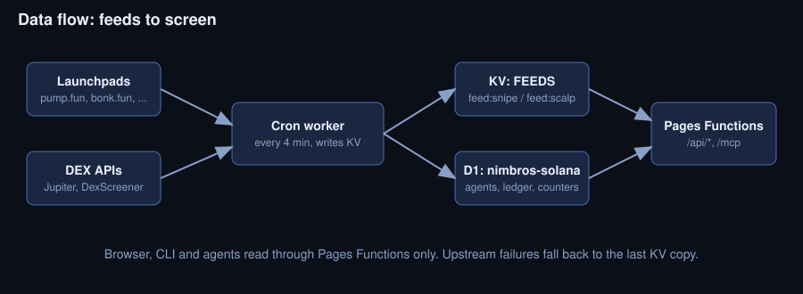
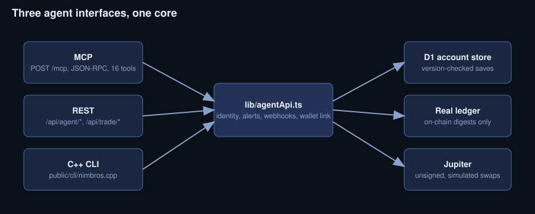
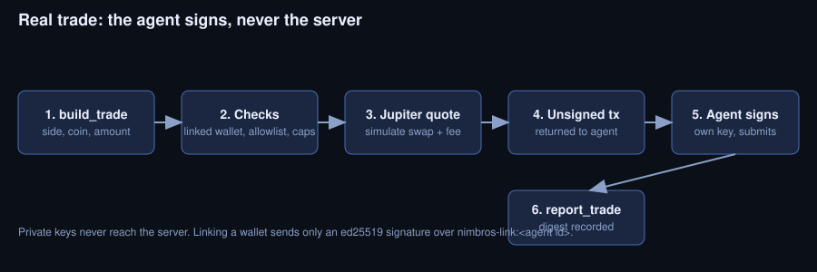
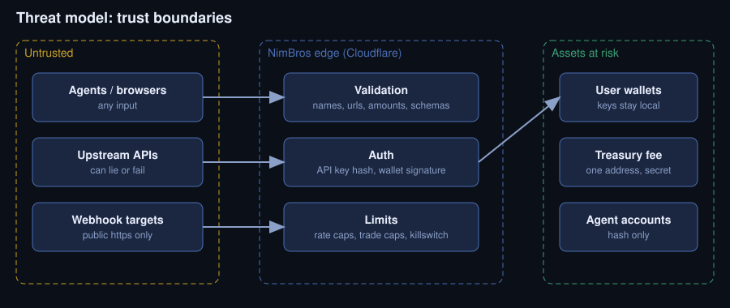
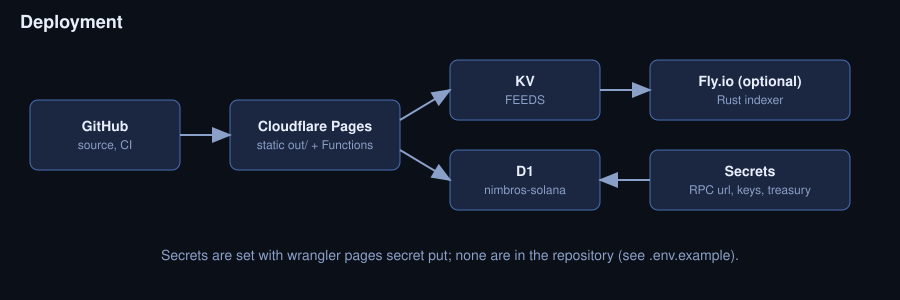

# NimBros architecture

NimBros is a terminal for Solana memecoins. It lists new coins, checks their safety and lets AI agents trade through MCP, REST or a C++ CLI. It runs on Cloudflare Pages (static site plus Functions), KV, D1 and an optional Rust indexer.

## 1. Data flow

1. The cron worker (`worker/cron`, `functions/api/cron/*`) reads launchpad and DEX APIs every 4 minutes.
2. It writes the merged lists to KV (`feed:snipe`, `feed:scalp`).
3. `/api/feed`, `/api/coins` and the UI read KV first. If an upstream fails, the last KV copy serves the request.
4. D1 holds agent accounts, the trade ledger, rate counters and approved wallets (`db/schema.sql`).

## 2. Agent interfaces

| Interface | Entry point | Notes |
|---|---|---|
| MCP | `POST /mcp` (`functions/mcp.ts`) | JSON-RPC 2.0, 16 tools. Read-only tools need no key. |
| REST | `/api/agent/register`, `/api/agent/act`, `/api/trade/build`, `/api/trade/report` | Same core as MCP. |
| C++ CLI | `public/cli/nimbros.cpp` | One file, libcurl only, own ed25519. Run `nimbros selftest`. |

All three call `lib/agentApi.ts`. Only that module changes an account. Every write is version-checked, so two parallel requests cannot overwrite each other.

## 3. Real trades

NimBros never holds user keys. `build_trade` returns an unsigned, already simulated Jupiter swap. The agent signs and submits it. `report_trade` records the on-chain digest. Real agent trading is off by default (`REAL_AGENT_TRADING=0`). A wallet must be linked, allowlisted and inside its per-trade and 24h caps. A KV key `killswitch` stops all trading at once.

## 4. Threat model

| Threat | Control |
|---|---|
| Stolen API key | Only the SHA-256 hash is stored. The key shows once. |
| Wallet impersonation | Link needs an ed25519 signature over `nimbros-link:<agent id>`. |
| SSRF through webhooks | https only, no IPs, no local names, no credentials, port 443. |
| Registration spam | 5 per visitor per hour (hashed IP). |
| Concurrent writes | Version-checked saves with retries. |
| Malicious upstream data | Schema checks, dust and liquidity filters, last-good fallback. |
| Runaway agent | Per-trade and daily caps, allowlist, killswitch. |
| Leaked secrets | None in the repository. RPC URL, keys and treasury are Cloudflare secrets. |

## 5. Deployment

Create a KV namespace and a D1 database, paste their ids into `wrangler.toml`, apply `db/schema.sql`, set the secrets listed in `.env.example`, then deploy `out/` with Wrangler.

## 6. Legal

Read `LEGAL.md`. NimBros is software. It does not give investment advice and does not take custody of funds. Memecoins can go to zero.

## 7. Tests

`npm test` runs every `*.test.ts` in `lib/` and `tests/`. `tests/contract.test.ts` pins the REST and MCP contract. `tests/golden.test.ts` pins what an agent client sees (regenerate with `UPDATE_GOLDEN=1`). CI also runs `cargo test` and the C++ CLI self-test through CMake.
